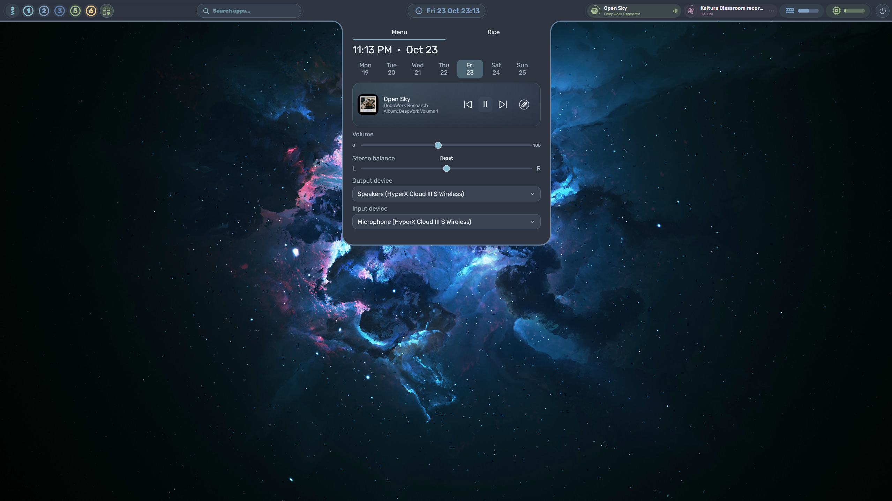

# nord-rice

A Nord-themed top bar for [GlazeWM](https://github.com/glzr-io/glazewm) on Windows, built on [Zebar](https://github.com/glzr-io/zebar), with native helpers for the parts a web widget can't do well.

<!-- Replace with a short screen recording: docs/demo.gif -->


## Features

- **Bar**: workspaces, an editable app search, a taskbar of the current workspace's apps, a clock, Spotify and Helium media controls, volume, CPU and memory, a VPN status pill, an inline tray that expands in the bar, and a power button. The bottom edge is a thin Nord-blue line.
- **Control center**: hover the clock to preview the panel; click the clock (or Pin in Menu) to keep it open. Escape or an outside click dismisses it. The bar's bottom line bends around it as it opens.
  - **Menu tab**: clock, a selectable full-month calendar, Google Calendar/Tasks timeline and pinning.
  - **Audio tab**: media player, master volume/mute, stereo pan, input/output selection, microphone mute and per-app volume.
  - **Rice tab**: appearance (frosted glass, transparency, blur, grain, corner radius, wallpaper colors) and indicator keybinds.
  - **Focus tab**: optional goal, custom work/break timers, pause/resume, +5 minutes and reversible app hiding.
  - **Rice > Widgets & layout**: show, hide and reorder bar widgets, then press Apply.
  - **Glaze tab**: GlazeWM title bars, window corners, borders (with a 1–8 px focus-border thickness drawn by the control center), unfocused-window fade and gaps, written to its config and applied right away; reloads keep your focus and cursor where they were.
- **Spotlight**: Ctrl+Space opens a floating launcher; typing in the bar shows the same providers underneath it. Apps, calculations/conversions, personal files/folders, running windows, URLs, web searches and slash commands are supported. `/help` lists commands; `/launch` opens your usual apps. See [Spotlight](docs/spotlight.md).
- **Alt workspace switcher**: hold left Alt to see your workspaces; it follows Alt+number switching and fades on release. Choose Classic, large neighboring Gallery cards, or the typographic Ribbon in Rice. See [indicator styles](docs/workspace-indicators.md).
- **Wallpaper switcher**: hold Right Ctrl and press [ or ] to step through a folder of numbered images (1, 2, 3, …) on a sliding thumbnail strip; release to apply with a fade (Esc cancels). Win+[ and Win+] do the same with taps.
- **Power menu**: Shutdown, Restart, Sleep and Screensaver over a blurred, dimmed desktop on every monitor.
- **Low overhead**: the helpers sleep until you use them, so idle CPU is close to zero.
- **Multi-monitor and mixed scaling**: each monitor gets its own bar, and panels render at that monitor's scale.

## Requirements

- Windows 10 or 11 with .NET Framework 4.8 (built in)
- [GlazeWM](https://github.com/glzr-io/glazewm) 3.x and [Zebar](https://github.com/glzr-io/zebar) 3.x: `winget install glzr-io.glazewm glzr-io.zebar`
- [Node.js](https://nodejs.org) LTS, to build the bar: `winget install OpenJS.NodeJS.LTS`
- Optional: [btop4win](https://github.com/aristocratos/btop4win), opened by the CPU and memory widgets (otherwise Task Manager opens)
- Optional: [Spicetify](https://spicetify.app), to show the Spotify album and playlist and to copy track links

## Install

For automatic dependency installation and clean defaults, see [easy installation](docs/easy-install.md). From the complete source tree, run `powershell -NoProfile -ExecutionPolicy Bypass -File .\setup.ps1`. The GitHub bootstrap is prepared but needs your published repository URL.

Start GlazeWM once so it creates its config, then in this folder run:

```powershell
powershell -ExecutionPolicy Bypass -File .\install.ps1
```

The installer:

1. Checks the requirements above.
2. Downloads two pinned NuGet packages used to build the control center (NAudio and .NET reference assemblies) and verifies their SHA-256.
3. Generates random tokens that protect the local connections between the bar and its helpers.
4. Builds the bar and the three helpers.
5. Installs everything to `%USERPROFILE%\.glzr\zebar\nord-rice`.
6. Updates GlazeWM's `config.yaml` (after backing it up): starts and stops the helpers with GlazeWM, stops GlazeWM tiling their windows, and binds Ctrl+Space to Spotlight if that shortcut is free.
7. Sets Zebar to start this bar (replacing the original Nord bar if you had it), then restarts Zebar.

Re-run it any time to update. It keeps your settings and tokens.

### Options

| Option | Effect |
|---|---|
| `-PackDir <path>` | Install somewhere else under `%USERPROFILE%\.glzr\zebar\` |
| `-BtopPath <path>` | Path to `btop4win.exe` if it isn't found automatically |
| `-Spicetify` | Install the Spotify link extension into Spicetify and run `spicetify apply` |
| `-SkipGlazeConfig` | Leave GlazeWM's config alone (add the entries below yourself) |
| `-MigrateFrom <path>` | Copy settings and tokens from an older install folder |
| `-BackupDir <path>` | Where backups go (default `.\backups`) |
| `-NoRestart` | Don't restart Zebar and the helpers at the end |
| `-Rebuild` | Recompile every helper, even if its source hasn't changed |

### GlazeWM entries (if you use `-SkipGlazeConfig`)

```yaml
general:
  startup_commands: ['shell-exec %USERPROFILE%/.glzr/zebar/nord-rice/NordSpotlight.exe --background', 'shell-exec %USERPROFILE%/.glzr/zebar/nord-rice/NordWorkspaceIndicator.exe', 'shell-exec zebar']
  shutdown_commands: ['shell-exec taskkill /IM NordSpotlight.exe /F', 'shell-exec taskkill /IM NordWorkspaceIndicator.exe /F', 'shell-exec taskkill /IM NordControlCenter.exe /F', 'shell-exec taskkill /IM zebar.exe /F']

window_rules:
  - commands: ['ignore']
    match:
      - window_process: { regex: '^(NordSpotlight|NordControlCenter|NordWorkspaceIndicator)$' }

keybindings:
  - commands: ['shell-exec %USERPROFILE%/.glzr/zebar/nord-rice/NordSpotlight.exe']
    bindings: ['ctrl+space']
```

Replace `%USERPROFILE%` with your full user folder path if GlazeWM doesn't expand it.

## Customize

| What | Where |
|---|---|
| Which widgets show, their order and side | Control center, **Layout** tab |
| Frosted glass, blur, brightness, transparency, grain, wallpaper-matched colors | Control center, **Rice** tab → Appearance (saved in `bar-appearance.json`). Frosted glass shows the blurred wallpaper behind the bar, control center, Alt switcher, Spotlight and wallpaper strip, so they read as one pane (rendered by the control center to `frost-DISPLAYn.jpg`); transparency sets how much tint sits on top. Colors come from Wallpaper Engine's current preview when it runs, else the Windows wallpaper, and update when it changes. Gentle Focus sessions keep the current palette. GlazeWM's window borders follow the edge color too (focused window: the edge; others: a dimmed edge). |
| Wallpaper folder and hotkeys | `wallpapers.json` in the install folder (`folder`, `next`, `previous`); indicator hold keys are configurable in CC > Configure and saved in `indicator-keys.json`. Static Windows wallpapers; Wallpaper Engine, if running, draws over them. |
| Screen frame (Caelestia-style rounded inset around each monitor) | Control center, **Rice** tab → Screen frame (0 = off); GlazeWM's edge gaps grow by its thickness automatically |
| Control center max height | Half of the current monitor height, accounting for scaling; taller tabs scroll |
| Apps opened by `/launch` | `launch-apps.json` in the install folder |
| Workspaces: names, Alt-switcher labels, monitors, default apps | `workspaces.json` in the install folder. See [Workspaces](docs/apps-and-layout.md#workspaces) |

## Uninstall

1. Delete `%USERPROFILE%\.glzr\zebar\nord-rice`.
2. Remove the `nord-rice` entry from `%USERPROFILE%\.glzr\zebar\settings.json`.
3. In GlazeWM's `config.yaml`, remove the `Nord*` startup and shutdown commands, the rule marked `# nord-rice helper windows`, and the Ctrl+Space binding marked `# nord-rice floating Spotlight`. Or restore a copy from `backups\glazewm-configs`.

## Troubleshooting

- **Control center doesn't open**: hover the clock on a visible bar. It doesn't open while a full-screen app covers the bar.
- **Search or control center shows "reconnecting"**: the helpers may not be running. Re-run `install.ps1`, or start `NordSpotlight.exe --background` from the install folder.
- **Windows says "An Application Control policy has blocked this file"**: Smart App Control judges unsigned programs one build at a time, and the helpers are compiled on your PC, so a build can be blocked. Run `install.ps1 -Rebuild` to compile a fresh copy; the installer otherwise keeps builds that already run.
- **Your user folder name contains spaces**: commands are quoted for GlazeWM, but this path is less tested. Please open an issue if something doesn't start.

## Development

| Path | What |
|---|---|
| `src/` | Bar UI (SolidJS + Vite). `npm run build:glazewm` builds to `dist/glazewm`. |
| `control-center/` | WPF helper: control center, power menu, bridge on port 6138. `build.ps1`; `check.ps1` builds tests to run in `checks/`. |
| `spotlight/` | WPF search helper, bridge on port 6137. `build.ps1` |
| `workspace-indicator/` | WPF Alt workspace switcher. `build.ps1` |
| `shared/` | Code shared by the helpers (bridge tokens). |

`install.ps1` (or `./rebuild.sh` from Git Bash) rebuilds and reinstalls everything.

## Credits and license

Built on the [Nord theme for Zebar](https://github.com/quangbhdang/zebar-nord) by Dang Quang; the original README is in `docs/upstream-README.md`. Colors follow the [Nord](https://www.nordtheme.com) palette. MIT licensed; see `LICENSE` and `THIRD-PARTY-NOTICES.md`.

## Gentle Focus sessions and indicator keys

Open **Focus** for an optional goal, custom work/break minutes, pause/resume, +5 minutes and an app hide list. Breaks can start automatically; the next work session waits for you. A compact countdown appears beside the bar clock. Hidden windows return on pause, break or end. Your palette and workspaces stay unchanged; apps are never force-closed.

The Focus tab is built on first use and its UI timer stops while hidden. All five tabs use the monitor-specific max-height setting (50% by default). In **Rice > Keybinds**, choose and apply hold keys for the workspace and wallpaper indicators. Defaults are **Left Alt / Right Ctrl**, and changes apply immediately. See [Focus and keybind details](docs/focus-and-keybinds.md) for recovery, storage and behavior.

The taskbar shows the current monitor's workspace windows. Click to restore/focus; right-click for **Focus window** or **End task**. End task force-closes the selected app process and can discard unsaved changes.

### Shared rice font

Control Center > Configure > Font is an editable dropdown. It lists up to seven unique font families from `Documents/99 - Archive/Fonts` (including subfolders). Choose a family, or type an installed font family name and press Enter or leave the field. Empty text restores the saved value. Archive fonts load directly without Windows installation; use Refresh beside the font field after adding new files to the archive.

The choice persists in `bar-appearance.json` and updates Zebar, Control Center, the Alt workspace indicator, wallpaper picker, Spotlight, and native menus. Symbol/icon fonts stay separate. Rebuild and install with `powershell -ExecutionPolicy Bypass -File .\install.ps1` to update a running installation.

Control Center tabs fit their contents up to half the current monitor resolution height, including the top edge and accounting for display scaling. Taller tabs scroll; opening the center on another monitor recalculates the limit. The legacy `maxHeight` layout setting is ignored; `transitionMs` still controls tab transitions.

## Shell polish

The bar uses neutral idle labels and transparent controls, with accents reserved for selected workspaces, active apps and status feedback. The clock shows a short date and time; its tooltip carries the full date. Its timer wakes at minute boundaries.

Menu keeps the clock and calendar. Focus has its own lazy-loaded tab for goals, custom work/break sessions and reversible distraction hiding. Audio groups the media player, master volume/mute, stereo balance, output/input selection, microphone mute and app volumes. Hover the clock to preview Control Center; click the clock or Pin to keep it open. Escape or an outside click closes it.

Bars subscribe once and receive initial state plus changed-channel updates. A shared helper samples master audio/focus at most once a second across monitors, and pins/rules/VPN every five seconds. Clients send only a ten-second heartbeat while idle and resubscribe on reconnect. Disabled volume/VPN widgets skip those shared samples. Device changes and external config edits still have polling fallbacks. Font bytes use a separate cached channel and are sent only on connection or font changes. Frost image generation already caches wallpaper/material/monitor inputs; the Control Center now also reuses its cropped frost brush until those inputs or its position change.

Validation: `control-center/check.ps1` and `control-center/checks/CenterChecks.exe` cover native layout/state. `node checks/shell-polish/check.mjs` builds an isolated bar fixture with synthetic providers and WebSocket messages, then checks initial push, live audio, pin commands, heartbeat cadence and reconnect at 1920px/100% and 2560px/125%. The fixture never contacts the running helpers or changes live audio. It uses Playwright with local Microsoft Edge. `npm run build -- --configLoader runner` is available when the sandbox prevents the default config bundler from traversing parent directories.

## Audio tab and expanded Spotlight

Control Center tabs are Menu, Audio, Rice, Glaze and Focus. Audio contains the media player, master volume/mute, stereo pan, input/output selection, microphone mute, and the app mixer. Menu keeps the clock and calendar; Focus has its own work/break timer tab. The panel defaults to 759 logical pixels wide; width and max height are configurable in Rice. Widgets & layout sits above Keybinds in Rice. Audio has ribbon sensitivity directly below the player; sliders pair up where space allows and stack at narrow widths. All tab scrollbars and Spotlight use the shared slim scrollbar with a fixed gutter.

Spotlight supports calculator functions and unit conversions, files/folders, running windows, websites/web searches, Windows Settings and 19 discoverable slash commands. See [Spotlight](docs/spotlight.md) for examples, keyboard shortcuts and search scope. CPU/memory hover values are centered in their meter slots; workspace app icons share a soft group surface.

## Google Calendar timeline

Menu shows every week of the displayed month (Sunday–Saturday) and a selectable-day Timeline. Arrows navigate by month; Today returns to the current month/day. Read-only calendar sync supports multiple private iCal feeds without Google Cloud: choose **Private iCal** in CC to add each calendar. Optional Google Calendar + Google Tasks sync uses native desktop sign-in. Follow [Google Calendar setup](docs/google-calendar.md) for either connection method. No account is connected automatically. The calendar follows the existing theme and fixed scrollbar gutter.

Wallpaper changes can also update a blurred lock-screen copy. Configure **Rice > Lock screen** for sync and blur; status appears in that section. See [lock-screen sync](docs/lock-screen-sync.md). Editable CC controls include small inline descriptions, grouped for related actions.

Wallpaper indicator categories follow your library subfolders. **All** combines the library; root images appear under **Uncategorized**. Hold the indicator key and use **Up/Down** for categories, **Left/Right** or **[ / ]** for images. Category chips are clickable; the last category and per-category positions are saved. See [wallpaper categories](docs/wallpaper-categories.md).

Spotlight **/openall** opens the app list selected in **Configure > Spotlight: /openall apps** (the old /launch name remains an alias). **/closeall** force-terminates live workspace taskbar apps across monitors without save prompts; unsaved changes can be lost. The desktop shell and rice/system helpers are protected. See [app batch commands](docs/spotlight-app-batches.md).

### Sign-in startup

GlazeWM starts NordRuntime in its own session and privilege context. The runtime starts Control Center (which owns the screen frame) before Zebar and keeps the helpers available while GlazeWM is running. The installer removes the obsolete Nord Rice Logon task and its Startup-folder fallback; it preserves other startup entries. The runtime no longer tries to launch GlazeWM itself.

The screen frame starts before the full Control Center UI. Startup yields between service stages so its windows can paint immediately, using the saved wallpaper palette/frost and the preset's known 50-DIP bar height before WebView2 is visible. Each monitor switches to actual Zebar bounds when discovered; game visibility behavior remains in place. Slow service stages and frame initialization are recorded in `wallpaper.log` as `startup <stage>: <milliseconds> ms`.

The bar restores its last saved display settings immediately while connecting to Control Center. Live settings then replace that cache. Actual sign-in timing depends on GlazeWM's startup, Windows and WebView2; verify the next sign-in. `runtime.log` records helper launches.

### Notification center

The far-left bell or configurable Win+Shift+N shortcut opens a full-height notification panel, source/search filters, read/pin/archive/history, per-item Windows dismissal and Focus completion events. Enable the optional Windows collector with `install.ps1 -Notifications`, then **notification bell popup > Connect Windows**. This installs a per-user package with a local signing certificate and requires Windows notification-access permission. See [setup, privacy and verification limits](docs/notification-center.md).

### Wallpaper-tinted app windows

CC > Configure > Appearance > App windows adds an optional Mica/Mica Alt preset for Windhawk's Translucent Windows mod. It is off by default, supports exclusions and restores previous settings when disabled. See [setup, compatibility and recovery](docs/app-window-tint.md). This affects supported app backgrounds; custom-drawn apps still need individual themes.
