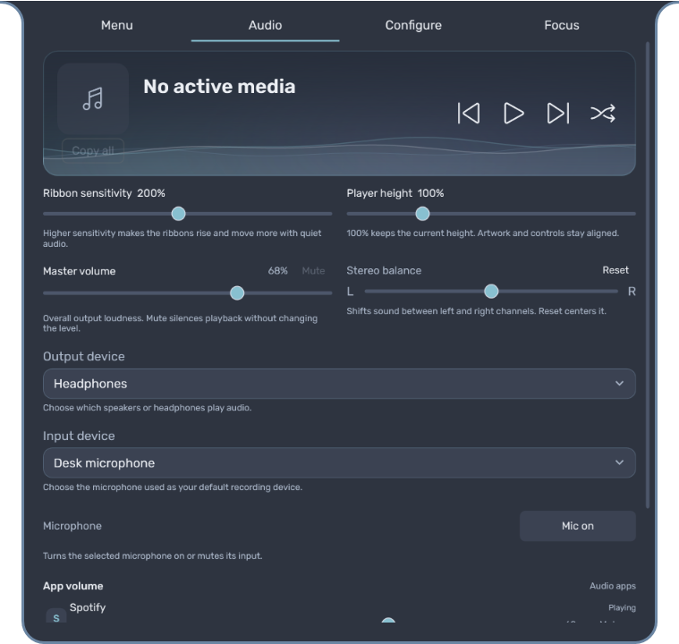
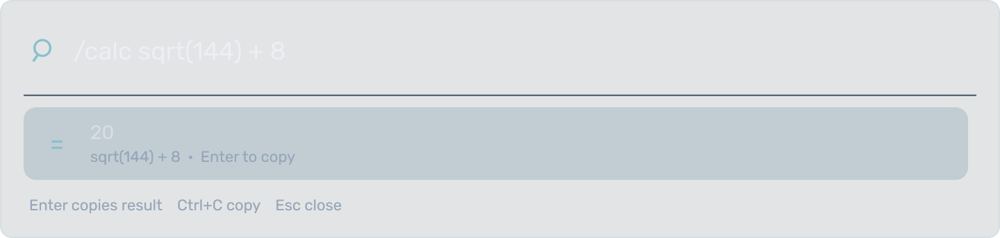

# Rime

A wallpaper-driven Windows rice built around **GlazeWM**, **Zebar**, and custom native helpers. Frosted surfaces, coordinated colors, workspace tools, and everyday controls in one configurable desktop.

Inspired by the feel of Caelestia, adapted to Windows. Rime is a customization layer, not a replacement for the Windows shell.

<!-- Add the full desktop walkthrough video here when ready. -->

## Install

Run in **64-bit Windows PowerShell**:

```powershell
irm https://raw.githubusercontent.com/liamstonestreet/Rime/main/bootstrap.ps1 | iex
```

The command downloads the source from this repository and runs its installer. You can [read the bootstrap first](bootstrap.ps1). It requires the installation files to be published to `main`.

Setup reuses detected installations and installs missing **Node.js LTS, GlazeWM, and Zebar** through WinGet. It attempts to repair WinGet if necessary, initializes a missing GlazeWM configuration, builds the helpers, and installs Rime to:

```text
%USERPROFILE%\.glzr\zebar\nord-rice
```

Existing Rime settings and bridge tokens are preserved. GlazeWM configuration changes are backed up. Fresh installs use neutral workspace rules and the bundled wallpaper library. Git and Visual Studio are not required.

**Requirements:** 64-bit Windows 10/11 with .NET Framework 4.8 and its compiler, an internet connection, and permission to install missing applications. Windows may request administrator approval for dependencies. Portable/custom app locations and managed Windows policies may require manual setup.

Prefer a local installation? Download/extract this repository, open PowerShell in its folder, and run:

```powershell
powershell -NoProfile -ExecutionPolicy Bypass -File .\install.ps1 -CleanDefaults
```

Re-run the bootstrap to update, or run `install.ps1` from an existing local source folder. Updates restart the bar and helpers. See [installation details and options](docs/easy-install.md).

> Installation scripts and components have local checks, but the complete clean-Windows installation matrix has not yet been verified. This is an actively developed rice.

## Make it yours

1. **Open Control Center:** hover the bar's clock to preview it, or click to pin it open.
2. **Configure the bar:** in **Configure → Widgets & layout**, choose what appears and where, then Apply.
3. **Choose a look:** adjust fonts, wallpaper colors, transparency, blur, contrast, grain, rounded corners, and the screen frame. CC width and maximum height are editable.
4. **Browse wallpapers:** hold **Right Ctrl**, browse, then release to apply. Configure → Wallpaper library selects your own folder or returns to the presets.
5. **Set up workspaces:** pin apps from their taskbar context menu and configure assignment rules for your workflow.

GlazeWM owns the workspaces and launches the recovery runtime. Start GlazeWM to start the rice; configure GlazeWM to launch at sign-in if you want Rime available after every login.

## What's included

### A bar that follows your desktop

- Per-monitor workspace numbers, a workspace taskbar, and Spotlight search.
- Show, hide, and reorder widgets across the left and right lanes.
- Pin apps to workspaces; drag taskbar icons to reorder them. Orders persist.
- Spotify and browser media widgets, CPU/memory meters, volume, VPN status, tray access, and power controls.
- Optional quick actions for Discord microphone mute, GitHub, and an Obsidian reflection note. Personal quick actions are disabled on clean installs; the Obsidian path currently needs customization in source.
- Wallpaper-derived colors, a configurable screen frame, and mixed-DPI monitor support.

### Control Center

| Tab | Controls |
| --- | --- |
| **Menu** | Sunday-first month calendar, selectable dates, daily event/task timeline, and a compact calendar/timeline layout. |
| **Audio** | Media playback, flowing audio ribbons, player height/sensitivity, master volume, stereo balance, input/output devices, microphone mute, and per-app volumes. |
| **Configure** | Appearance, wallpaper library, widgets/layout, GlazeWM window settings, indicator styles, panel animation choices, and keybinds. |
| **Focus** | Optional goal, custom work/break durations, pause/resume, extra time, session counts, and reversible distraction hiding. |

CC and Notifications each have independent **Slide** or **Fade** opening/closing styles. Panel height follows the selected monitor and configured limit; longer pages scroll.

*Interface preview rendered from the current code with sample device/app data. Live colors follow your wallpaper and configuration.*



### Spotlight

Search installed apps, running windows, local files/folders, websites, and Windows Settings. Calculate expressions, convert units, and copy results without opening a browser.

```text
sqrt(144) + 8
5 km to mi
/apps spotify
/windows notes
/settings sound
/openall
```

Use `/help` to explore commands. `/openall` launches the list you configure in CC; `/launch` remains an alias. **`/closeall` force-closes workspace applications and can lose unsaved work.**

File-name search covers Desktop, Documents, and Downloads with a bounded background index; it is not a full-disk or file-content search. [Search details and keyboard controls](docs/spotlight.md).

*Rendered interface preview showing the calculator provider.*



### Workspace and wallpaper indicators

Hold **Left Alt** for the workspace indicator. Choose **Classic**, **Gallery**, **Ribbon**, or **Zebar**. Zebar keeps the indicator around the bar's workspace numbers with a white outline that stretches and slides between selections. Indicator popups are suppressed while a detected game is focused; workspace shortcuts remain available.

Hold **Right Ctrl** for wallpapers. Choose **Classic**, **Showcase**, or **Filmstrip**; browse categories with Up/Down and images with Left/Right or `[` / `]`. Release to apply, or Escape to cancel.

The bundled **44 wallpapers** are organized into **Elden Ring, Ghibli, Nature, and Space**. **All** combines every category. Add JPG/JPEG, PNG, or BMP images to your library; top-level subfolders become categories. Configure → Wallpaper library provides **Choose folder**, **Open folder**, and **Use presets**. Existing users keep their selected folder on updates.

Wallpaper changes coordinate the desktop fade and theme colors. Optional lock-screen sync creates a blurred copy with configurable blur. [Wallpaper categories](docs/wallpaper-categories.md) · [Lock-screen sync](docs/lock-screen-sync.md).

### Notifications and focus

The configurable bell widget or **Win+Shift+N** opens a full-height left notification drawer. Search and filter by app, mark read, pin, archive, view history, or dismiss individual Windows notifications. Pinned items have a visible pin marker; app icons identify their source.

Windows notification collection is **optional** and needs the companion package plus Windows notification-access permission. Local inbox history is encrypted on the PC and bounded by retention limits. [Notification setup and behavior](docs/notification-center.md).

Focus sessions support custom work/break timers and an optional goal. Distraction hiding is reversible; apps return when the session is paused or ended. [Focus details](docs/focus-and-keybinds.md).

## Default controls

| Action | Default |
| --- | --- |
| Open floating Spotlight | Ctrl+Space, if available during installation |
| Open/pin CC | Hover/click the clock |
| Show workspace indicator | Hold Left Alt |
| Switch workspace | Alt+number, using your GlazeWM bindings |
| Previous/next workspace | Alt+[ / Alt+] |
| Show wallpaper indicator | Hold Right Ctrl |
| Browse wallpaper categories | Up / Down while the picker is open |
| Browse wallpaper images | Left / Right or [ / ] while the picker is open |
| Apply/cancel wallpaper | Release the hold key / Escape |
| Toggle Notifications | Win+Shift+N or click the bell |

Indicator hold keys and the notification shortcut are editable at the bottom of **Configure**. These are separate from GlazeWM's workspace bindings.

## Optional integrations

Rime runs without Spotify, Discord, Obsidian, Google services, or Windhawk.

- **Spotify links:** install Spotify and Spicetify first, then run `install.ps1 -Spicetify`. Adds track, artist, album, and playlist link copying, metadata, and shuffle control. The runtime checks for a missing/outdated patched extension at startup; Spotify may need reopening after repair.
- **Windows notifications:** run `install.ps1 -Notifications`, then use **Connect Windows** in the notification drawer. Packaging requires Windows SDK tools; setup involves signing trust and notification-access approval. [Guide](docs/notification-center.md).
- **Google calendars:** use multiple private iCal feeds for read-only events without Google Cloud, or configure desktop OAuth for Google Calendar and Tasks. Accounts are never connected automatically. [Guide](docs/google-calendar.md).
- **Wallpaper-tinted app backgrounds:** optional Windhawk Translucent Windows integration with exclusions and rollback. Support varies by app. [Guide](docs/app-window-tint.md).
- **System monitor:** CPU/memory widgets open detected btop4win, otherwise Task Manager.

## Troubleshooting and development

- **An optional feature is empty:** check its connection/setup guide above; enabling a widget does not install or authenticate its app.
- **Wallpapers missing:** check Configure → Wallpaper library, then reopen the picker after changing folders.
- **Startup/recovery issues:** inspect `runtime.log` and `wallpaper.log` in the installed pack. [Runtime recovery](docs/runtime-recovery.md).
- **Changes not visible:** rebuild/reinstall from the source folder. `-Rebuild` recompiles all helpers; `-NoRestart` installs without restarting them.

Rime uses a Solid/TypeScript bar, .NET Framework/WPF helpers, and local authenticated WebSocket bridges. Internal executable/pack names remain `Nord*` and `nord-rice` for existing-install compatibility. [Architecture and source map](docs/architecture-guide.md).

Build the bar with `npm.cmd ci` followed by `npm.cmd run build -- --configLoader runner`. Each native helper has a `build.ps1`. Tests and preview renderers live beside their source and under `checks/` and `scripts/`; generated output is ignored by Git. Helper builds need the dependencies provisioned by the installer. See the [performance notes](docs/performance.md) for measurement guidance; smoothness and resource use depend on hardware and workload.

## Credits and license

Created by Liam Stonestreet. Built on [GlazeWM](https://github.com/glzr-io/glazewm), [Zebar](https://github.com/glzr-io/zebar), and [Dang Quang's Nord preset](https://github.com/quangbhdang/zebar-nord), with inspiration from [Caelestia](https://github.com/caelestia-dots/shell).

Code is MIT licensed; see [LICENSE](LICENSE) and [third-party notices](THIRD-PARTY-NOTICES.md). Upstream attribution is preserved in [the original preset README](docs/upstream-README.md). Bundled wallpapers remain subject to their respective creators' rights; the code license does not grant ownership of that artwork.
