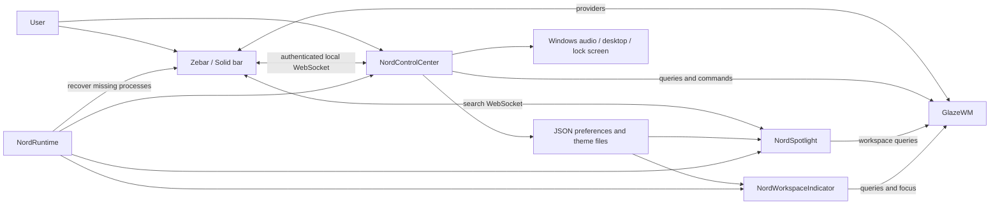

# How the rice works

For the proposed incremental cleanup of the window and static services, see [Control Center cleanup plan](control-center-cleanup-plan.md).

This guide describes the current active Rime implementation, including the code added and adapted during this session. It does not claim authorship of Zebar, GlazeWM, NAudio, Windows APIs, or bundled dependencies. Historical experiments, backups, vendored reference code, binaries, generated screenshots, and dependency files are not additional application layers.

## The running system

The rice consists of cooperating programs rather than one executable:

| Program | Responsibility |
|---|---|
| GlazeWM | Owns real workspaces, window placement, focus and app rules. Our code queries it and generates selected configuration sections. |
| Zebar | Hosts the HTML/CSS/Solid bar, normally one browser surface per monitor. |
| NordControlCenter.exe | Hosts native CC, audio controls, wallpaper picker, shared theme coordination, frame, menus and Windows integrations. |
| NordSpotlight.exe | Hosts native search UI, search providers, command execution and a local search bridge. |
| NordWorkspaceIndicator.exe | Hosts the hold-to-browse workspace overlay and its presentation variants. |
| NordRuntime.exe | Watches for missing rice processes and restarts them while GlazeWM is running. |

The local CC bridge uses port **6138**; Spotlight's bridge uses **6137**. Install-generated tokens authenticate connections. JSON files persist preferences and share selected state across processes. Shared C# files are compiled into several executables: they do **not** create shared memory. Each process has its own static fields and object instances.

## Reading the design as OOP

There are four useful roles:

| Role | Examples | Meaning |
|---|---|---|
| Models | `AppearanceSettings`, `WorkspaceApp`, `CalendarItem`, `FocusState`, `WallpaperCategory` | Represent settings, identities and current state. Some also validate, match or calculate from their data. |
| Views | `CalendarView`, `MediaCard`, `FocusView`, `WallpaperPicker` | Own visual controls and interaction state. Most inherit a WPF container/window. |
| Coordinators | `NordControlCenter`, `BarAppearance`, `FocusMode`, `DesktopWallpaper` | Sequence operations involving multiple services/views. |
| System adapters/services | `DiscordVoice`, `BarAudio`, `GlazeCommand`, `GoogleCalendarSource` | Translate app intentions into Windows, GlazeWM, network or file operations. |

**Composition** is the main relationship: CC contains a CalendarView, MediaCard, MicControl and VolumeMixer. It does not inherit from those components. **Inheritance** mostly supplies WPF behavior: `MediaCard : Grid`, `CalendarView : StackPanel`, `WallpaperPicker : Window`. **Polymorphism** is clearest in `ICalendarSource`: the view can consume real Google/iCal sources or a synthetic test source through the same contract. `IWallpaperFadeCover` similarly allows real desktop overlays to be replaced in tests.

Many services are static classes. The frontend uses functions, Solid signals and components instead of a class hierarchy. The implementation is therefore a hybrid service/component design, not strict MVC or MVVM. In particular, native views currently contain some event handling and coordination that a larger application might put in separate view-models.

## Bar: source files

Paths in the following tables are relative to the Rime repository root.

| File | Responsibility |
|---|---|
| `src/glazewm.tsx` | Frontend entry point: mounts the bar, provider context and CC connection lifecycle. |
| `src/components/nord-bar.tsx` | Composes left/right widget lanes, taskbar icons, centered clock and horizontal frame edge. |
| `src/index.css` | Base styling and CSS imports. |
| `src/frost-bar.css` | Main theme, widget surfaces, frame geometry, hover behavior, scrolling and small animations. |
| `src/components/bar/glazewm.tsx` | Workspace buttons and workspace focus interaction. |
| `src/components/bar/workspace-tasks.tsx` | Combines pins with actual workspace windows; renders icons; handles focus, launch, menus and pointer-based persistent reordering. |
| `src/components/bar/workspace-rules.tsx` | App-rule widget and its automatic-placement toggle. |
| `src/components/bar/direction.tsx` | Displays/changes tiling direction. |
| `src/components/bar/datetime.tsx` | Clock and CC anchor/toggle interaction. |
| `src/components/bar/spotlight.tsx` | Search field and keyboard interactions routed to Spotlight. |
| `src/components/bar/quick-actions.tsx` | Reflection note, Discord mute toggle and GitHub buttons. |
| `src/components/bar/media.tsx` | Reusable Spotify/Helium player widget and media controls. |
| `src/components/bar/media.css` | Player widget layout, fixed empty/playing widths and interaction styling. |
| `src/components/bar/volume.tsx` | Master volume/mute widget using the native CC audio bridge. |
| `src/components/bar/volume.css` | Volume widget presentation. |
| `src/components/bar/cpu.tsx` | CPU meter and system-monitor launch action. |
| `src/components/bar/memory.tsx` | Memory meter and system-monitor launch action. |
| `src/components/bar/tray.tsx` | Requests the native tray popup. |
| `src/components/bar/vpn.tsx` | VPN connection indicator and Windows VPN settings action. |
| `src/components/bar/power.tsx` | Opens the native power menu. |

Frontend services and state:

| File | Responsibility |
|---|---|
| `src/lib/rice-widgets.ts` | CC WebSocket connection, reactive state signals, packet routing and outgoing commands. Rejects callbacks from obsolete connections. |
| `src/lib/appearance.ts` | Applies appearance/font/frame/frost settings to CSS; rejects older versioned snapshots and preserves good wallpaper colors during incomplete updates. |
| `src/lib/theme-transition.ts` | Shared-clock palette interpolation and frost crossfades through requestAnimationFrame. |
| `src/lib/provider-registry.ts` | Reference-counted provider ownership; delays stops so moving a widget cannot destroy a feed another instance still uses. |
| `src/lib/providers-context.tsx` | Lazily exposes CPU, memory, media and GlazeWM providers to widgets. |
| `src/lib/player-sessions.ts` | Selects the intended Spotify/Helium media session. |
| `src/lib/bar-layout.ts` | Normalizes saved widget lane/order settings and handles older layouts. |
| `src/lib/screen.ts` | Converts browser coordinates to physical monitor coordinates, including mixed DPI. |
| `src/lib/edge-metrics.ts` | Calculates pixel-aligned line/frame dimensions at fractional scaling. |
| `src/lib/pack.ts` | Resolves installed pack/helper paths without hard-coding the username. |
| `src/lib/spotlight-bridge.ts` | Builds the authenticated local Spotlight endpoint URL. |
| `src/lib/install-config.generated.ts` | Installer-generated local tokens/paths; machine-specific output, not a hand-edited portable default. |
| `src/lib/utils.ts` | Small general-purpose frontend helpers. |

## Native Control Center: source files

These files live in `control-center/`. A C# file may contain several related classes; a file is not itself an object.

| File | Responsibility |
|---|---|
| `NordControlCenter.cs` | WPF window/application startup, page composition, anchor/hover integration and rendering; delegates placement and animation to owned controllers. |
| `PanelPlacementController.cs` | Physical-pixel positioning and monitor constraints, with injectable monitor/native-position adapters and no-activation Windows positioning. |
| `PanelFrameGeometry.cs` | Pure frame outline points, radius limits and transparent/opaque bar-join geometry. |
| `ControlCenterTab.cs` | Stable tab IDs and explicit title/visual ordering definitions. |
| `PanelAnimationController.cs` | Tab/height/underline/reveal animations, completion revisions, delayed hide, temporary rendering subscription and disposal. |
| `RiceLayout.cs` | Builds appearance, dimensions, responsive slider pairs, lock-screen settings, widget layout and keybind sections. Contains the persisted `RiceSettings` layout model. |
| `BatchAppsView.cs` | Configurable `/openall` installed-app picker and save action. |
| `IndicatorKeyControl.cs` | Indicator hold-key selection, validation feedback and Apply/Defaults UI. |
| `GlazeTab.cs` | GlazeWM effects/gap controls; also contains config editing and corner synchronization helpers. |
| `DisplayCadence.cs` | Reads monitor refresh settings and assigns animation targets for the owning display. |
| `MediaBridge.cs` | Compatibility facade for bridge callers and metadata/heartbeat access; also retains native task-icon resolution. The CC owns its transport lifetime. |
| `BarBridgeServer.cs` | Loopback listener, authenticated upgrade, bounded client count, frame reads and connection shutdown. |
| `BridgeConnection.cs` | Per-connection bounded ordered writer, failure/disposal handling and `BridgeWire` framing helpers. |
| `BridgeHub.cs` | Subscription barrier: full initial state before buffered/live updates; bounded pending capture state. |
| `BridgeCommandRouter.cs` | Typed parsing of existing message strings and isolated dispatch-error handling. |
| `BridgeApplicationCommands.cs` | Adapts typed commands to current services/UI actions and assembles the initial channel snapshot. |
| `MediaMetadataStore.cs` | Validated Spotify URL/title/album/playlist state and freshness checks. |
| `BarState.cs` | Central status sampler/cache so each monitor does not duplicate audio/VPN/workspace polling. |
| `BarAppearance.cs` | Compatibility facade over one instance-owned theme coordinator; retains existing callers and bridge-facing snapshot APIs. |
| `AppearanceSettings.cs` | Appearance model, defaults, validation and copy semantics. |
| `AppearanceSettingsStore.cs` | Atomic appearance JSON persistence, prior-file backup and unknown-field preservation. |
| `ThemeCoordinator.cs` | Appearance state/revisions, owned polling and asynchronous preparation/UI commit ordering; rejects stale work. |
| `WallpaperLookPreparer.cs` | Warm palette reuse and staged frost work, with frost clearing deferred until commit. |
| `AppearancePublisher.cs` | Separate cached font payload channel and unchanged-state publication suppression. |
| `WindowsThemeHost.cs` | External adapters for source images, palette extraction, frost, dispatcher, shared transitions, borders and bridge delivery. |
| `ControlCenterTheme.cs` | Maps semantic roles such as Text, Accent, Raised and Hover to live brushes; updates existing controls without rebuilding them. |
| `NordMenu.cs` | Shared non-activating themed context menu; dismisses on outside click/Escape. |
| `TaskActions.cs` | Validates taskbar windows, focuses them and supplies window menu actions; contains `GlazeCommand`. Both the explicit End task action and `/closeall` can terminate app processes. |
| `TaskPins.cs` | Pin/move/unpin context menus, app identity resolution, atomic workspace-rule edits and persistent taskbar ordering. Reuses canonical launcher rules and scopes browser pins by title to avoid cross-workspace conflicts. |
| `WorkspacePins.cs` | Builds pin snapshots from rules/catalog data, generates pin icons and launches or focuses pinned apps. |
| `WorkspaceLaunchPolicy.cs` | Pure first-open-window policy: baseline/reconnect safety, other-window exclusion, tray-app support, web-app identity and bounded initial identity settling. |
| `WorkspaceLaunchRouter.cs` | Lifecycle subscription and read-only snapshots over two GlazeWM sockets; targets only an eligible new window by ID, with no idle polling or focus commands. |
| `WorkspaceConfig.cs` | Validates workspace definitions, generates the owned Glaze config sections, preserves other config, and watches workspace JSON changes through `WorkspaceSync`. Generated configuration removes unconditional native assignments. Startup-only routing is controlled by the app-rules marker; unsafe broad task-pin duplicates are omitted from the runtime rule set. |
| `QuickActions.cs` | Reflection note creation/opening, GitHub opening and Discord action dispatch. Older Discord popup code remains as compatibility functionality. |
| `DiscordVoice.cs` | Discovers Discord's accessible voice controls and invokes/reads mute/deafen state with bounded asynchronous work. |
| `BarAudio.cs` | Static bridge compatibility facade and instance command/cache handler; uses the shared Windows audio adapter for master volume and explicit mute/unmute. |
| `AudioPage.cs` | Audio tab construction, device/slider/button UI events and discovery coordination; accepts an injected controller/endpoint service. |
| `AudioController.cs` | Instance-owned CC audio state, detached device snapshots, commands and revision guards against stale discovery. Defines the endpoint interface used by fake tests. |
| `WindowsAudioEndpointService.cs` | NAudio and Windows default-device adapter; acquires and disposes endpoints within each operation without passing COM objects between worker and UI threads. |
| `StereoBalance.cs` | Channel-balance calculation and live endpoint writes through injectable accessors. |
| `MicControl.cs` | Selected microphone state and mute interaction. |
| `VolumeMixer.cs` | App/session mixer models, activity retention, session sampling and per-app volume/mute controls. |
| `MediaCard.cs` | Native media player, artwork, metadata and controls. Also contains `MediaAtmosphere` ribbon rendering and `WinRT` async adapters. |
| `VpnStatus.cs` | Detects active VPN-like adapters and opens Windows VPN settings. |
| `TrayPopup.cs` | Native system tray popup lifecycle, anchoring and interaction. |
| `PowerMenu.cs` | Compatibility facade over the application-owned power menu controller. |
| `PowerMenuController.cs` | Multi-monitor overlay windows, captures/blur images, themed brushes, timers and disposal. |
| `PowerActions.cs` | Injectable power-action dispatcher, preview suppression and Windows shutdown/restart/sleep/screensaver/lock adapter. |
| `CalendarData.cs` | Calendar event/task models, Sunday-first month-grid calculations, time/date interpretation and `ICalendarSource`. |
| `CalendarView.cs` | Full-month selection/navigation, month animation, timeline display and connection controls. |
| `CalendarConnections.cs` | Encrypted private-iCal connection storage, feed downloads and merging with optional Google API data. |
| `CalendarFeedDialog.cs` | Private calendar name/link editing and saving. |
| `GoogleCalendar.cs` | Desktop OAuth/PKCE, encrypted Google credentials/tokens and Calendar/Tasks API requests. |
| `IcalData.cs` | iCalendar parsing, recurrence expansion, time zones, exceptions and cancelled/moved events. |
| `FocusSession.cs` | Pure work/break state transitions: start, pause, resume, extend and phase completion. |
| `FocusMode.cs` | Session persistence/recovery and reversible hiding/restoration of selected app windows; includes legacy lock-in support. |
| `FocusView.cs` | Goal, durations, countdown/ring, session buttons and distraction-app settings. Built lazily. |
| `WallpaperLibrary.cs` | `WallpaperLibraryService` scanning boundary, category grouping/sorting, compatibility helpers and browser-state model. |
| `WallpaperBrowserStateStore.cs` | Atomic category/position JSON loading/saving with prior-file backup. |
| `WallpaperPicker.cs` | Hold/timed wallpaper browser, category chips/navigation, selection, bounded thumbnail cache and release/cancel behavior. |
| `WallpaperVariants.cs` | Showcase/Filmstrip retained carousel/card layouts and selection animations. |
| `WallpaperSwitcher.cs` | Indicator hotkeys, shutdown hooks, `DesktopWallpaper` facade and native `CoverWindow`. |
| `WallpaperCoordinator.cs` | Instance owner of serialized preparation/application, prepared bitmaps, active covers and disposal; defines `IWallpaperPlatform`. |
| `WindowsDesktopWallpaperRenderer.cs` | Windows wallpaper layout/decode/commit, cover creation and theme/compositor adapters. |
| `WallpaperFadeAnimator.cs` | Per-fade render subscription, shared-clock alpha updates, completion wake-up and cancellation cleanup. |
| `HoldKey.cs` | Low-level hold/release/Escape and image/category navigation keyboard handling on a separate hook thread. |
| `WallpaperTheme.cs` | Locates static/Wallpaper Engine sources and extracts theme colors using OKLab clustering. |
| `LockScreenWallpaper.cs` | Compatibility facade for the owned lock-screen service. |
| `LockScreenService.cs` | Serialized/latest-request generation, status and disposal, with injectable native WinRT platform adapter. |
| `LockScreenImageBuilder.cs` | Separate blurred lock-screen copy generation; preserves the original source. |
| `FrostMaterial.cs` | Builds per-monitor blurred wallpaper material and stages/commits the set together. |
| `ScaledDecode.cs` | Decodes images at bounded sizes instead of loading full-resolution wallpaper data everywhere. |
| `CenterBackdrop.cs` | Paints the desktop-derived material behind CC at its monitor/DPI position. |
| `Grain.cs` | Produces the optional grain texture. |
| `ScreenFrame.cs` | Rounded screen-edge frame on each monitor and related edge-gap coordination. |
| `EdgeGlow.cs` | Glow/edge drawing support shared by native frame rendering. |
| `GlazeBorders.cs` | Applies final native border colors immediately; persists them and refreshes GlazeWM once per changed palette with workspace/cursor preservation. No per-frame border animation. |
| `FocusBorder.cs` | Separate thick focus-outline overlay implementation; currently disabled because of workspace-switch tracking bugs. It is not the screen frame. |

## Shared C# source

These files live in `shared/` and are compiled where needed.

| File | Responsibility |
|---|---|
| `AppShortcuts.cs` | Discovers missing Start Menu shortcuts (including browser web apps), preserves shortcut launch targets, and resolves window app identity/relaunch icon metadata. |
| `AppCatalog.cs` | Installed-app entries, workspace-rule models/matching, validated launch behavior and bounded local app-usage history. |
| `AppIcons.cs` | AppID/executable icon extraction, caching and native icon-resource cleanup. |
| `BatchAppSettings.cs` | `/openall` selections, legacy-name migration compatibility and atomic saves preserving unrelated JSON settings. |
| `BridgeTokens.cs` | Loads and validates per-install bridge credentials. |
| `FocusTheme.cs` | Focus settings/session/recovery data models read by multiple helpers. |
| `IndicatorKeys.cs` | Valid hold-key choices, persistence and change watching. |
| `WallpaperPalette.cs` | Persisted wallpaper palette, default colors and color interpolation helpers. |
| `ThemeTransition.cs` | Shared timestamp/revision transition model, rendering-clock updates and theme-file watching. A completion wake-up settles hidden surfaces too. |
| `FrostFile.cs` | Reads/caches the relevant frost image region with weak references and controlled image ownership. |
| `RiceLook.cs` | Shared appearance-file access, font discovery/loading, motion timing and roundness utilities. |
| `ScrollChrome.cs` | Consistent narrow scrollbar templates and gutter behavior for native UI. |

## Spotlight, workspace indicator and runtime

| File | Responsibility |
|---|---|
| `spotlight/NordSpotlight.cs` | Search window, keyboard selection/completion, result list and action dispatch. |
| `spotlight/SearchProviders.cs` | Search result model, slash-command discovery, app/window/file/path/web/settings search routing. |
| `spotlight/Calculator.cs` | Calculator expression parser and unit conversion. |
| `spotlight/WindowSearch.cs` | Glaze/native running-window discovery, window focusing and installed-app catalog refresh. |
| `spotlight/WorkspaceBatch.cs` | `/openall` configured launches and `/closeall` force termination of validated live workspace app processes. |
| `spotlight/SearchBridge.cs` | Authenticated local search connection used by the bar. |
| `spotlight/SpotlightTheme.cs` | Spotlight's use of shared colors, frost, font and motion settings. |
| `spotlight/AppUsageTracker.cs` | Foreground-activation tracking used for local app ranking without periodic whole-process scans. |
| `spotlight/launch-apps.ps1` | Older launch-batch implementation retained for compatibility; the current `/openall` command uses native `WorkspaceBatch` instead. |
| `workspace-indicator/NordWorkspaceIndicator.cs` | Workspace overlay window, Glaze queries, hold-key lifecycle, focus actions and presentation coordination. |
| `workspace-indicator/IndicatorVariants.cs` | Gallery/Ribbon presentation alternatives alongside the classic view. |
| `runtime/NordRuntime.cs` | Per-session process recovery, suspend/resume handling and recovery logging. Does not intentionally kill/restart a healthy Zebar process. |

## Configuration, installation and generated output

The source tree is the workshop. The installed pack normally lives at `%USERPROFILE%\.glzr\zebar\nord-rice`. Its executables, shared state and preferences are colocated so helpers agree on file locations.

| File or category | Responsibility |
|---|---|
| `install.ps1` | Resolves dependencies/paths, builds, backs up the old install, copies output, preserves existing preferences, generates tokens/catalog/privileges, configures startup and starts the installed rice. |
| Each helper's `build.ps1` | Compiles that C# executable; check switches build isolated verification targets. |
| `vite.config.ts`, `package.json`, `tsconfig.json` | Frontend compilation, packages/scripts and TypeScript checking. Lock files pin dependency resolution. |
| `glazewm.html` | HTML host for the frontend entry point. |
| `zpack.json` | Zebar pack/widget metadata, monitor placement and allowed shell commands. |
| `workspaces.json` | Workspace names, labels, monitor assignments, app rules and persistent pin metadata. |
| `public/rice-widgets.json` → installed `rice-widgets.json` | Widget visibility and left/right lane order. |
| `control-center/control-center-layout.json` | CC tab-motion timing settings. |
| `control-center/control-center-styles.xaml` | Native control templates and styles. |
| Installed `bar-appearance.json` | Fonts, tint, frost, radius, motion, CC dimensions, player/ribbon settings and lock-screen preferences. |
| `indicator-keys.json` | Workspace/wallpaper indicator hold keys. |
| `wallpapers.json` | Wallpaper library path and timed-cycle bindings. |
| Installed `wallpaper-browser.json` | Last wallpaper category and per-category selected paths. |
| Installed `taskbar-order.json` | Per-workspace app-icon ordering. |
| `spotlight/launch-apps.json` → installed `launch-apps.json` | `/openall` selected AppIDs/legacy names and preserved older batch settings. |
| `control-center/focus-mode.json`, installed `focus-state.json` | Focus preferences versus current recoverable session state. |
| Installed `spotlight-apps.json`, `spotlight-history.json` | Machine-generated app catalog versus personal local usage ranking. |
| Installed `bridge-tokens.json`, `runtime-zebar.txt` | Bridge credentials and resolved Zebar executable path. |
| Installed `wallpaper-theme.json`, `theme-transition.json`, `frost-*.jpg` | Published theme state/timing and regenerable material caches. |
| `open-player.ps1` | Fixed supported-player launch routing for the bar. |
| `resources/workspace-cycle-keybindings.yaml` | Workspace cycling bindings installed into GlazeWM. |
| `resources/game-window-rules.yaml` | Optional/preset game-window handling rules used by setup. |
| `scripts/setup/*.ps1` outside the pack | One-off setup/migration/font tasks; the Windhawk isolation script preserves exclusions and can enable future crash dumps. These are not continuous application services. |
| `scripts/diagnostics/*`, `checks/memory-snapshot.ps1` | Read-only diagnostic utilities and machine-specific snapshots. |
| `dist/`, helper `.exe` files, `.build-stamp`, preview PNGs | Generated output, not the authoritative source to edit. |
| `docs/` | Feature behavior, setup, architecture and investigation notes. |

Calendar credentials/private feeds are stored separately under `%LOCALAPPDATA%\NordRice\GoogleCalendar` using Windows user encryption. Blurred lock-screen copies live under `%LOCALAPPDATA%\NordRice\LockScreen`. Neither should be treated as portable source defaults.

## Verification files

Checks replace risky operations with fixtures/delegates rather than closing real apps, changing wallpapers or muting a real call.

| File | What it checks |
|---|---|
| `control-center/PanelPlacementChecks.cs` | Fake monitor/position targets test mixed DPI, negative origins, constraints, anchored resize and pure frame geometry. |
| `control-center/PanelAnimationChecks.cs` | Synthetic checks for interrupted transitions, hide cancellation and timer/frame cleanup. |
| `control-center/ThemeCoordinatorChecks.cs` | Fake-host lifecycle/order/last-good-state checks and isolated settings-store migration/backup tests. |
| `control-center/WorkspaceLaunchChecks.cs` | Synthetic first-window/tray launches, existing windows, repinning, reconnect and shared-browser identity checks; no live moves. |
| `control-center/PowerActionChecks.cs` | Fake action dispatch, preview/dismiss suppression and invalid action rejection. |
| `control-center/CenterChecks.cs` | Native integration runner: page layout, controls, DPI/height limits and component suites. |
| `control-center/CalendarChecks.cs` | Month/date selection, timeline ordering, month boundaries, Google date/task semantics and OAuth helpers. |
| `control-center/IcalChecks.cs` | Private feeds, recurrence/time-zone handling, merging and encrypted connection behavior. |
| `control-center/FocusChecks.cs` | Session timing, recovery and reversible mocked window hiding. |
| `control-center/WallpaperChecks.cs` | Indicator styles, release/cancel, selection and bounded preview resources. |
| `control-center/WallpaperCategoryChecks.cs` | Category scanning, All/root/nested files, remembered selections and style integration. |
| `control-center/WallpaperFadeChecks.cs` | All-monitor cover preparation, shared fade/commit ordering and image lifetime. |
| `control-center/LockScreenChecks.cs` | Separate blur copies, source preservation, coalescing, disabled sync and mocked Windows rejection. |
| `control-center/MediaVisualChecks.cs` | Media layout/rendering, player-height settings, ribbon response and display animation targets. |
| `control-center/StereoBalanceChecks.cs` | Actual channel-write requests, reset with an unchanged slider and refresh suppression. |
| `control-center/TaskPinChecks.cs` | Pin creation/moving/unpinning, preserved rule metadata and order persistence. |
| `control-center/QuickActionChecks.cs` | Reflection filenames/no overwrite, action routing and mocked Discord behavior. |
| `control-center/ThemeTransitionChecks.cs` | Shared timing, brush interpolation, cleanup, one mocked native border refresh per palette and stale-write rejection. |
| `control-center/BridgeOrderingChecks.cs` | Isolated ordering/barrier, slow-client, bounded-queue, failure and state-lock concurrency checks using memory streams. |
| `control-center/BridgeProtocolChecks.cs` | Ephemeral-loopback server auth/framing/reconnect/control-frame/disposal checks plus typed routing and metadata tests. |
| `control-center/FocusBorderChecks.cs` | Native overlay stacking rules, retained for the disabled thick-border feature. |
| `control-center/FrameGlowChecks.cs` | Pixel-aligned bar/CC/frame joins across DPI scales. |
| `spotlight/SpotlightChecks.cs` | Search/calculator/command behavior, file search and native result layouts. |
| `spotlight/WorkspaceBatchChecks.cs` | Batch command discovery/scope with fake launch and close operations. |
| `workspace-indicator/IndicatorVariantChecks.cs` | Indicator variants and their selection/render behavior. |
| `checks/shell-polish/check.mjs` | Headless Edge integration of actual bar components, real mouse reordering, bridge reconnection, stale-theme regressions and multiple DPI scales. |
| `checks/shell-polish/zebar.ts`, `index.html` | Synthetic provider data and browser test host. |
| `checks/frame-glow/*` | Browser/native edge rendering fixtures and thickness comparisons. |

## Example collaborations

**Changing wallpaper:** HoldKey reports the held key → WallpaperPicker selects a WallpaperCategory/image → thumbnails and desktop material are prepared → DesktopWallpaper asks BarAppearance for the next palette/frost and shared start time → native windows and browser surfaces interpolate against that timestamp → desktop covers fade → Windows commits the actual image → LockScreenWallpaper queues its separate blurred copy → covers/previews are released.

**Pinning an app:** workspace-tasks sends a context request → TaskPins validates the window and resolves its app identity → NordMenu offers the action → workspaces.json is updated atomically → WorkspaceConfig/WorkspaceSync regenerate the owned rule section → WorkspacePins broadcasts the new pin list → Solid signals update the bars. Reordering changes taskbar-order.json, not window placement.

**Calendar:** CalendarView chooses a displayed month/date → an ICalendarSource loads that visible range → CalendarConnections merges private iCal and optional Google results → CalendarSnapshot.ForDay selects/orders items → the view renders the chosen date's timeline. Fake sources implement the same interface in tests.

**Reset balance:** the Reset button explicitly invokes the audio setter even if its slider already reads zero → StereoBalance writes both channel values using the live endpoint level → the UI reads the actual result → an older asynchronous device refresh is prevented from replacing the newer edit.

**Spotlight commands:** bar search sends a request through SearchBridge → SpotlightSearch produces typed SpotlightResult objects → NordSpotlight dispatches the selected result → WorkspaceBatch reads live workspace windows and BatchAppSettings. `/openall` launches configured missing apps; `/closeall` force-terminates each validated workspace app process once, protecting the shell and rice services and reporting failures.

**Recovering from a crash:** NordRuntime notices a missing process and starts it → the new bar reconnects → the helper supplies a complete versioned snapshot → stale messages cannot overwrite the restored wallpaper palette. Recovery restores availability; it does not diagnose or repair the native crash itself.

## Application lifetime

`ControlCenterApp.cs` handles the executable entry flow, registration and single-instance signalling. `AppServices.cs` is the composition root: it starts application services and disposes them in reverse order, including rollback after partial startup. The window starts interaction explicitly, and its disposable pages stop polling, subscriptions and pending reads when retired. `AudioPeakSampler.cs` owns the media meter endpoint on a single lazy MTA worker, including recovery and disposal.

Static facades retained for compatibility delegate to the extracted owners. Geometry, parsing and other pure helpers stay static. The migration and resource ownership map are recorded in [control-center-cleanup-plan.md](control-center-cleanup-plan.md). Comparable live measurements and both-monitor smoke checks remain necessary before drawing conclusions about performance or native crash stability.
## Notification inbox

`NotificationInbox.cs` owns deduplication, local state, bounded history and debounced persistence behind `INotificationStore`. `NotificationCenter.cs` connects that instance to application lifetime, Focus events, the badge and authenticated bridge commands. `NotificationsView.cs` is the lazy, virtualized WPF inbox. `shared/NotificationItem.cs` is the shared transport model; `NotificationActivation.cs` launches the companion through its package identity. `notifications/NordNotificationListener.cs` owns Windows listener permission/events, native-dismiss validation and its reconnecting bridge client. `notifications/install.ps1` packages/signs/registers the optional companion only when the installer receives `-Notifications`.

See [notification setup and implementation status](notification-center.md) for the supported features and live-verification boundary.
