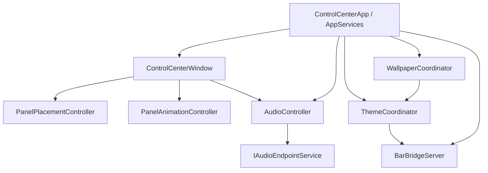

# Control Center cleanup plan

This is an incremental refactor plan. Implementation progress is recorded below; unmarked phases remain proposed. The current implementation is mapped in [architecture-guide.md](architecture-guide.md). Preserve visible behavior, settings, executable boundaries and bridge contracts while extracting one responsibility at a time.

## Progress: first audio slice

Implemented `AudioController`, detached `AudioSnapshot`/`AudioDeviceChoice` values and `IAudioEndpointService`, with a `WindowsAudioEndpointService` adapter. The CC window delegates device discovery, selection, endpoint reads, mute, volume and balance writes to these collaborators. It no longer imports NAudio or retains an `MMDevice`; the adapter acquires and disposes endpoints within each operation on the same thread. Native default-device COM declarations moved out of the window too.

Revision tickets preserve edits overtaken by asynchronous discovery, including mute changes. Reset still writes both channels even when the UI is already centered, retains live loudness and shows actual device readback. A refresh requested while discovery is busy is queued rather than dropped. Fake-endpoint controller checks and the existing native CC checks pass; production compilation passes. No live audio writes or bar restart were performed during verification.

The second audio slice completes the remaining phase 1 extraction: `AudioPage` now owns Audio tab construction, slider/button/device events, readback and discovery coordination. The window supplies visibility-driven ticks and refresh requests. Its close path disposes the page, preventing late discovery from repainting it. The former window-level mutable reset callback is removed; a real Reset button is now exercised through an injected controller and fake endpoint.

`BarAudio` retains its existing static bridge API as a compatibility facade over an instance-owned `BarAudioCommands`. It uses the same Windows endpoint adapter as the CC. Bar commands still resolve the current default output in one operation, retain the 500 ms status cache, preserve percent-volume JSON and use explicit mute/unmute rather than toggles. Fake tests cover validation, cache behavior and missing-device recovery. The bar's volume operation preserves its prior semantics rather than imposing the CC slider's explicit balance command.

Discovery runs on a worker; slider writes and periodic level reads still execute synchronously on the UI thread, as before. Mic controls, per-app mixer and media rendering retain their existing owners. The endpoint adapter retains no background timers or endpoint resources requiring shutdown disposal. No memory/performance improvement is claimed without a comparable measurement. Phase 0's full performance/ownership baseline remains to be recorded before broader service/lifetime work. Phase 2 is recorded below.

## Progress: phase 2, placement and animation

Implemented `PanelPlacementController` with injectable monitor and position adapters. Physical-pixel placement, mixed-DPI double positioning, anchor-preserving width edits, monitor width/height constraints and reentrant position correction now live there. `WindowsPanelPositionTarget` retains the native no-size/no-z-order/no-activation flags. Pure `PanelFrameGeometry` calculates the outline points and radii; the window still owns and paints the WPF path.

`ControlCenterTab` supplies stable identity, with an explicit ordered definition list for titles and visual columns. Page construction and button selection use IDs. Index accessors and a thin index entry point remain for characterization checks, not as the source of tab identity.

`PanelAnimationController` now owns height, underline, horizontal page, vertical reveal/conceal and temporary shape-tracking animation state. Revisions guard stale completion callbacks; an incoming page's old clocks are removed before its new base values are assigned. Reopening cancels a pending delayed hide. Disposal stops the hide timer, releases the rendering subscription and clears owned clocks. The window's close path also stops its hover timer and removes its appearance/frost event handlers.

Verification: fake placement tests cover positive/negative monitor coordinates and 100/125/150/175/200% scales, anchored resizing, narrow-monitor bounds and reentrant correction. Synthetic animation checks cover interrupted tabs and height clocks, underline width, hide/reopen and disposal. Existing CC checks still pass for both detected monitors, all tabs and frame joins; the rendered Audio preview was inspected. Production compilation passes. No live CC positioning, workspace changes or bar restart were used for these checks; a live mixed-DPI smoke check remains useful after installation.

Anchor file parsing, hover/hit testing, native bar discovery and screen-gap publication stay with the window's current integration code. Whole-application composition/lifetime cleanup remains phase 6. Phase 3 is recorded below.

## Progress: phase 3, appearance coordination

`BarAppearance` is now a compatibility facade over an owned `ThemeCoordinator`. `AppearanceSettings` is a separate validated model, persisted by `AppearanceSettingsStore` through atomic replacement with a `.bak` of the prior file. Unknown JSON fields are merged forward, including when a newer client has written fields this build does not understand. Settings updates become visible only after a successful save; returned settings and palettes are copies.

`WallpaperLookPreparer` owns warm palette reuse and staged frost preparation. `AppearancePublisher` owns font payload caching and unchanged-state suppression. `WindowsThemeHost` adapts the existing palette, frost, transition, native-border and bridge APIs so fake-host checks can exercise the coordinator without desktop effects. The bridge protocol, file names, numeric appearance revisions, independent font channel and future transition timestamp are preserved.

The preparation pipeline uses asynchronous serialization and awaits an asynchronous dispatcher commit. It holds no state lock while waiting for UI, writing palette/transition files or broadcasting. Settings edits invalidate prepared generations immediately; an explicit wallpaper switch retries preparation with the latest settings rather than applying an obsolete look. Missing sources retain the last-good palette. Frost-off clearing is staged until the coordinated commit instead of clearing active files during preparation. Polling starts once, is disposed at application exit, and queued commits check disposal before applying effects.

Verification: native CC checks and new fake-host checks pass for shared timing, warm reuse, motion-off, last-good palette, copied state, failed-save rollback, settings validation/backups/unknown fields, independent font caching, stale UI commits, settings edits during explicit switches, staged frost clearing and disposal. Production compilation passes. Existing checks now change settings through `Update` instead of mutating the returned object. No live bar install, wallpaper/theme change or measured after-install performance comparison was performed.

A read-only live memory snapshot and short CPU sample are recorded in [theme-cleanup-baseline.md](theme-cleanup-baseline.md), together with the current ownership inventory. The full controlled interaction/transition timing baseline remains pending; these samples are not a leak test or proof of improvement. Existing global frost/transition/native-border implementations remain behind the host adapter for their later lifetime cleanup. Phase 4 is recorded below.

## Progress: phase 4, bridge transport and routing

`MediaBridge` is now a compatibility facade. `BarBridgeServer` owns the loopback listener, authenticated handshake, reader threads and active clients. `BridgeConnection` owns each ordered writer queue and its failure/disposal path; `BridgeWire` handles framing. `BridgeHub` owns subscriptions and publication. `BridgeCommandRouter` parses legacy wire messages into typed commands; `BridgeApplicationCommands` adapts them to existing services. `MediaMetadataStore` owns validated Spotify context and the existing 45-second freshness policy.

New subscribers register as initializing before state capture. Capture happens outside the hub lock, so state producers can publish while holding their own locks without a lock-order deadlock. The complete font/appearance/channel snapshot and request reply are queued first, followed by buffered updates in publication order; later updates join the same connection queue. Repeated subscriptions are idempotent. Legacy `widgets` clients receive the same initialization barrier. Appearance revisions and existing frontend guards against disconnected sockets remain unchanged; no wire-format migration is required.

A stalled client no longer blocks writes to the others. Each outbound/pending-initial queue has a 16 MiB byte budget; an overflowed or failed connection is retired and can reconnect for fresh state. The listener remains loopback-only on port 6138 with the existing token check, eight-client limit, five-second handshake read timeout, three-second send timeout and 512 KiB incoming-command limit. Ping/pong and close frames use the ordered writer too. Diagnostics identify command kinds and disconnection reasons without logging tokens or message bodies. The CC window now retains/disposes its bridge and closes the listener and clients on window close.

Verification: memory-stream tests cover ordered broadcasts, initialization races, repeated subscriptions, slow/failed clients, initial/live queue limits, capture failure, and a state producer holding its own lock during capture. An isolated server on an OS-assigned ephemeral loopback port verifies auth rejection/acceptance, initial/reconnect ordering, legacy widgets, command round trips, ping/pong/close and listener/client disposal. Parser/framing tests cover extended lengths, masking, size limits, coordinate handling, rejected commands and Spotify validation/expiry. The existing native CC suite and production build pass. No production listener was restarted and no real desktop command was executed by protocol tests.

The barrier orders connection packets; it is not a global transaction across all underlying settings/devices. Existing services still own their sampling and channel state. Full application composition and disposal of other static services remain phase 6. Phase 5 is recorded below.

## Progress: phase 5, wallpaper and overlay ownership

`DesktopWallpaper` is a compatibility facade over `WallpaperCoordinator`. The coordinator owns preparation records, decoded per-monitor bitmaps, serialized build/apply gates and the active fade covers. `IWallpaperPlatform` separates native effects from the pipeline; `WindowsDesktopWallpaperRenderer` implements decoding/layout, native covers, compositor presentation, desktop commit and the existing shared theme handoff. `WallpaperFadeAnimator` gives each fade its own rendering subscription, completion wake-up and cancellation cleanup.

The established ordering is retained: prepare all monitors, present transparent covers, prepare the theme, fade on its published schedule, present opaque covers, commit Windows wallpaper behind them, then release covers and buffers. Superseded queued choices skip; an already-visible transition completes before the next one. Disposal invalidates queued work, cancels the active fade, closes covers immediately, and retires buffers so an in-progress decode can finish and release its result safely. Tests use private fake platforms instead of mutating global production delegates.

`WallpaperLibraryService` and `WallpaperBrowserStateStore` separate scanning and atomic category/position persistence. State keeps the same JSON contract and now retains a prior-file backup. The picker owns its bounded thumbnail cache and decode gate, cancels image delivery on close, clears cached references and removes its frost event subscription. The switcher releases its indicator watcher and hotkeys on shutdown; `HoldKey` now posts shutdown to its message loop and unhooks in `finally`.

`LockScreenService` owns serialized/latest-request lock-screen generation and exposes status/events through the old `LockScreenWallpaper` facade. Native WinRT application is isolated by `ILockScreenPlatform`; pure copy/blur work lives in `LockScreenImageBuilder`. Disposal invalidates queued/building requests before they can invoke the Windows setter. An OS operation already issued cannot be undone by disposal.

`PowerMenuController` owns overlay windows, captured/blurred images, theme brushes and escape/dismiss/preview timers. `PowerMenu` remains the call-site facade. `IPowerActions`, `WindowsPowerActions` and `PowerActionDispatcher` separate native effects from presentation, validate actions and suppress all preview/dismiss actions. Controller cleanup releases image/window references and its shared-theme subscription; disposal cannot dispatch a pending menu action. The three actions above centered Screensaver/Lock layout is unchanged.

Verification: the native CC suite passes, including existing category/style/navigation/release/cancel cases, shared wallpaper/theme ordering, coalesced decode/apply requests, buffer retention and failure recovery. Added checks cover active-fade disposal, lock-screen build disposal, all five injected power actions, preview suppression and theme-subscription cleanup. The rendered power-menu preview was inspected. Production compilation passes. No real wallpaper/lock-screen/power action was performed, no live bar was restarted, and no after-install performance reduction is claimed.

Application exit stops these owners before appearance coordination. Work already inside native OS calls or image decoding may finish; its results are retired rather than forcibly aborting worker threads. Phase 6 now provides the application lifetime owner described below.

## Progress: phase 6, application lifetime

`ControlCenterApp` owns registration, single-instance signalling and the WPF application. `AppServices` is the composition root: it starts services in a defined order, arms cleanup before each start, and unwinds in reverse order on startup failure or exit. A cleanup exception is logged without skipping other owners. Registration arguments, named synchronization objects and executable paths remain compatible.

`NordControlCenter` constructs presentation and exposes explicit start/stop interaction methods. Construction no longer starts its bridge, hover polling or global callbacks. Shutdown stops the bridge and view interaction first, then popups, native overlays, wallpaper work, watchers and theme resources. Each popup has an independent cleanup step. Existing static facades still used by callers remain compatibility entry points; pure geometry and parsing helpers remain static.

| Resource | Cleanup owner |
|---|---|
| Bridge listener, clients and command ingress | `MediaBridge` / `BarBridgeServer` |
| Hover polling, callbacks, page animations | `NordControlCenter` / `PanelAnimationController` |
| Audio page, microphone and mixer polling | Disposable page/control owners |
| Retained audio peak endpoint | `AudioPeakSampler`: lazy worker creates, reads and releases it on one MTA thread |
| Calendar requests and HTTP clients | `CalendarView` and disposable calendar sources |
| Lazy Focus view polling | `FocusView` |
| Focus recovery and hidden-window restoration | `FocusMode.Stop`; saved session is retained |
| Workspace watcher/debounce and startup routing sockets | `WorkspaceSync.Stop` / `WorkspaceLaunchRouter.Dispose` |
| Border WinEvent hooks, frame panes and corner timers | `GlazeBorders`, `FocusBorder`, `ScreenFrame`, `GlazeCorners` stop paths |
| Theme clock, brush subscriptions and staged frost | `ThemeTransition`, `ControlCenterTheme`, `FrostMaterial` stop paths |
| Tray long-poll handles | Retired session wakes all waiters; last waiter releases its handle |
| Pending usage history | `AppUsage.Stop` stops the writer and flushes history |

Late view reads and native discovery results are ignored after disposal. Staged frost cannot be republished after shutdown; committed shared frost files remain available to the other helpers. In-flight OS calls or decoding can finish cooperatively; shutdown does not forcibly abort threads or undo completed user actions.

New fake-only checks verify ordered startup/reverse disposal, partial-startup rollback, cleanup failure isolation and repeated disposal. Audio peak checks cover lazy reuse, same-thread endpoint ownership, disconnected-device recovery and cancellation during an in-flight read. Native Control Center and Spotlight checks pass, and production Control Center, Spotlight and workspace indicator builds succeed. Indicator style checks pass. DPAPI round-trips remain skipped when the sandbox lacks a loaded Windows profile; no plaintext fallback is introduced.

Source implementation of phases 1–6 is complete. Live install/restart, repeated open/close on both monitors and comparable memory/CPU measurements remain deployment verification; no measured performance reduction or fix for the earlier native Zebar crash is claimed. The experimental thick focus border remains disabled.

## Why do it?

At the start of this plan, `NordControlCenter.cs` combined application startup, window construction, monitor placement, animation, tabs, audio devices and asynchronous refresh. The audio responsibilities have since moved into the collaborators described above. Many supporting services own global state through static fields. Those choices made iteration fast, but make resource ownership, ordering and isolated tests harder to reason about. Recent stereo-reset, stale-theme and monitor-placement bugs show where explicit boundaries would help.

The goal is a thin window with explicit collaborators and services whose lifetime is owned by the application. Keep .NET Framework 4.8 and C# 5 compatibility; manual constructor injection is sufficient. A new DI framework, runtime migration or wholesale MVVM rewrite is unnecessary for this work.

## Proposed responsibilities

| Proposed class or boundary | Current responsibility to move | Owns |
|---|---|---|
| `ControlCenterApp` / `AppServices` | Startup currently inside `NordControlCenter.Run` | Service construction, startup order, cancellation and reverse-order disposal |
| `ControlCenterWindow` | Remaining `NordControlCenter` view | Visual tree, user events and presentation only |
| `PanelPlacementController` | `Fit`, `Place`, `SnapToBar`, anchors, monitor bounds and width/height constraints | Monitor context, physical-pixel/DIP conversion and placement decisions |
| `PanelAnimationController` | Reveal/conceal, tab-height transitions, underline and shape tracking | UI-thread animation state and rendering subscriptions |
| `AudioController` | `RefreshAudio`, `RefreshLevels`, device selection, balance/reset and mute operations | Audio snapshots, ordered edits and stale-refresh protection |
| `IAudioEndpointService` | NAudio/Windows endpoint access, including overlapping `BarAudio` behavior | COM objects and endpoint-thread affinity |
| `ThemeCoordinator` | Stateful orchestration in `BarAppearance` and theme publication | Last-good palette, revisions and shared transition schedule |
| `AppearanceSettingsStore` | Appearance persistence | Validation, atomic writes and compatible defaults |
| `BarBridgeServer` and command router | Socket lifetime, subscription and command dispatch currently coupled to services | Connections, ordered outbound delivery and initial state handshake |
| `WallpaperCoordinator` | Stateful wallpaper switching orchestration | Serialized preparation/commit, cancellation and latest-request policy |
| `WallpaperLibraryService` / `WallpaperBrowserStateStore` | Library scanning and category/position persistence | Library snapshots and browsing state |
| `DesktopWallpaperRenderer` / `LockScreenService` | Windows wallpaper and lock-screen side effects | Native resources and bounded prepared-image caches |
| `PowerMenuController` / `IPowerActions` | Static overlay lifecycle and native power operations | Overlay windows, dispatcher lifetime and explicit action dispatch |

Retain existing page components such as `MediaCard`, `VolumeMixer`, `CalendarView` and `FocusView`. Extract an `AudioPage` around existing audio controls rather than rebuilding them. Introduce stable tab IDs instead of spreading numeric tab indices across layout code.

Arrows indicate dependency direction, not separate processes or threads. Shared C# files compiled into multiple executables still create separate instances in each process; communication remains through the existing bridges and persisted settings.

## State and lifetime rules

- Give each timer, event subscription, watcher, hook, socket and native/COM handle one owner. Owners implement `IDisposable`; application shutdown cancels work before releasing resources. Stop rendering and optional polling when their UI is hidden.
- Publish immutable or copied snapshots. Never hand consumers mutable service dictionaries. Preserve monotonic theme revisions and the shared future transition timestamp so every surface starts together.
- Keep UI work on its dispatcher. Perform scanning, image preparation and network work outside the UI thread; do not hold a service lock while synchronously invoking the dispatcher.
- Use `Task`-returning operations with observed failures; reserve `async void` for UI event handlers. Serialize operations that write the same endpoint or desktop state. Use request revisions to discard stale reads without discarding the user's latest edit.
- Preserve existing settings filenames and fields. Each store owns validation and atomic replacement; migrations must preserve unknown fields and retain a backup. Never persist credentials as plaintext on encryption failure.
- Keep pure helpers static when that is useful: `StereoBalance`, calendar calculations and geometry functions do not need service instances. Introduce interfaces at external boundaries, not around every class.
- Initially retain static facades that delegate to application-owned instances. Move callers gradually, then remove the facades once no callers depend on their global state. Replace mutable global test callbacks with injected adapters as those services migrate.

## Reviewable migration sequence

| Phase | Concrete work | Exit criteria |
|---|---|---|
| 0. Establish baseline | Inventory owners and subscriptions; record startup, idle CPU/private memory and wallpaper-change timing on both monitors. Capture existing config/bridge samples without secrets. | Existing native checks pass; baseline and ownership list are recorded. |
| 1. Audio | Extract endpoint adapter and controller; wire existing controls to snapshots and commands. Share endpoint behavior with `BarAudio` where appropriate. | Reset writes both channels even at centered UI position; loudness is retained; rapid edits beat stale refresh; device removal and errors remain usable. |
| 2. Window and tabs | Extract pure frame/placement calculations, monitor adapter and animation controller. Replace tab indices with IDs. | Same width/max-height behavior on both monitors; underline tracks resize smoothly; rapid tab switching and interrupted transitions settle correctly. No focus or cursor changes. |
| 3. Appearance | Separate settings, palette extraction, frost preparation and transition coordination. Keep old static API as a temporary forwarding facade. | Missing images retain last-good colors; stale publications cannot revert the palette; wallpaper and all surfaces share one transition clock. No GlazeWM reload. |
| 4. Bridge | Extract transport and typed command routing behind the existing protocol. Define a subscription barrier so a new client receives its initial snapshot before normal updates. | Ordered per-client messages, safe disconnect/reconnect, bounded failure handling and unchanged tokens/port/message compatibility. |
| 5. Wallpaper and overlays | Extract wallpaper orchestration and image/resource owners; then move power-menu actions behind `IPowerActions`. | Latest-request behavior, cancel/release, categories and lock-screen sync remain intact; no first-frame flash; power tests use fake actions. |
| 6. Finish lifetime cleanup | Move startup into composition root, remove unused static facades and audit every disposal path. | Window contains presentation/wiring rather than storage, endpoint access or native operations; service ownership is explicit; shutdown leaves no background work behind. |

Build and review each phase independently. Do not combine behavior redesign with responsibility extraction. Keep the shipped executable layout and install script working throughout. If a phase regresses behavior, revert that phase without requiring rollback of unrelated work.

## Verification and performance gates

Use the existing native checks as characterization tests, then add focused tests at extracted boundaries. Avoid tests that merely repeat constructor wiring.

- Placement: both monitors; 100/125/150/200% scaling; 144/60 Hz; open/close, pinning, resize and rapid tab changes. Check no activation, workspace switch or cursor warp.
- Audio: centered and hard-panned reset, muted/zero-volume endpoints, hardware quantization, mono devices, device removal and interleaved refresh/edit. Use fake endpoints for writes.
- Themes/bridge: delayed or out-of-order messages, reconnect during transition, missing wallpaper, rapid wallpaper changes and settings edits. Verify last-good palette and one synchronized schedule.
- Wallpaper: all three indicator styles, categories, release/cancel, bounded image caches and failed lock-screen policy. Use synthetic images and a fake setter.
- Power: centered 3+2 layout on narrow/wide surfaces, escape/outside dismissal, preview safety and action routing. Never execute shutdown, sleep or lock in automated checks.
- Lifetime: repeated create/show/hide/dispose cycles; verify subscriptions, timers, sockets and cached image references are released. Measure idle and interaction costs under the same monitor/layout conditions as phase 0.

Acceptance means behavioral parity plus clearer ownership and no measured performance regression. Record observations rather than promising a particular memory reduction. This refactor does not itself establish the cause of Zebar's native heap crash; retain the separate stability investigation. Keep the experimental thick focus border disabled until its own rendering/stacking work is explicitly scheduled.

## First implementation slice

Start with audio: introduce `IAudioEndpointService` and an `AudioSnapshot`, move device/level reads and balance writes into `AudioController`, and adapt the existing reset regression test to a fake endpoint. Preserve `audioEditRevision` semantics. Only after that slice passes should audio construction leave `NordControlCenter.cs`. This gives a small, useful first change with a known regression case before tackling the cross-process theme pipeline.
